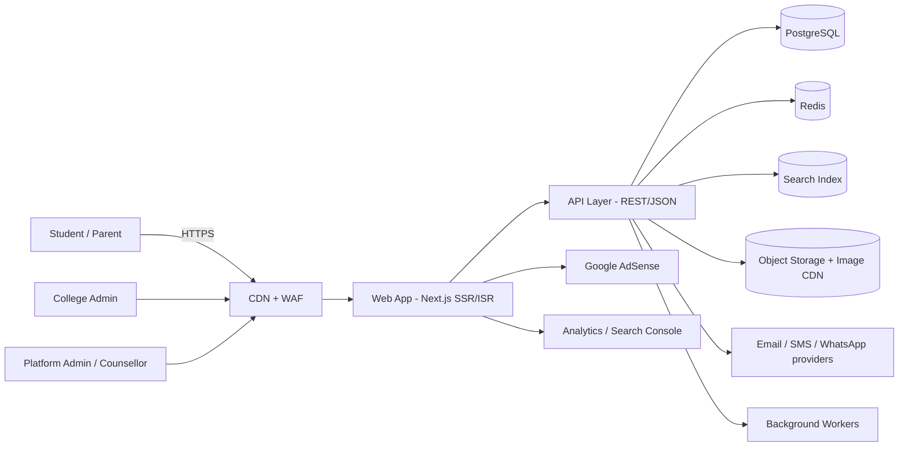
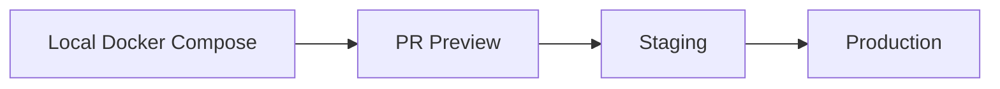

# 04 – Architecture

## 1. Architectural Goals

| Goal                         | Approach                                                        |
| ---------------------------- | --------------------------------------------------------------- |
| Fast on slow networks        | SSR/ISR, CDN edge caching, small JS bundles, image optimisation |
| SEO friendly                 | Server-rendered HTML, structured data, sitemaps                 |
| Maintainable by a small team | Modular monolith, typed code, one repo                          |
| Trustworthy data             | Versioned, audited records with source and verification dates   |
| Safe monetisation            | Isolated ad components, reserved space, consent-aware loading   |
| Room to grow                 | Clear module boundaries; extract services only when needed      |

## 2. System Context



## 3. Recommended Technology Stack

| Layer         | Choice                                                                                                                           | Reason                                                       |
| ------------- | -------------------------------------------------------------------------------------------------------------------------------- | ------------------------------------------------------------ |
| Frontend      | **Next.js (React) + TypeScript**, Tailwind CSS                                                                                   | SSR/ISR for SEO, strong ecosystem                            |
| UI components | Accessible component library (Radix/shadcn)                                                                                      | WCAG support                                                 |
| Backend       | **NestJS (Node.js, TypeScript)** modular monolith (or Next.js route handlers for MVP)                                            | Structure, DI, validation                                    |
| Database      | **PostgreSQL**                                                                                                                   | Relational data, full-text, JSONB, PostGIS for maps          |
| ORM           | Prisma or Drizzle                                                                                                                | Typed access, migrations                                     |
| Search        | PostgreSQL FTS + trigram for MVP → **Meilisearch/Typesense** at scale                                                            | Typo-tolerant, fast autosuggest                              |
| Cache         | Redis                                                                                                                            | Sessions, rate limits, hot queries                           |
| Media         | S3-compatible storage + Cloudinary/imgix or Cloudflare Images                                                                    | Resizing, WebP/AVIF                                          |
| Auth          | Auth.js / custom JWT + OTP, OAuth Google                                                                                         | Passwordless friendly                                        |
| Notifications | Email (SES/Resend), SMS via a Nepal provider **VERIFY**, WhatsApp link-outs                                                      | Reach students                                               |
| Jobs          | BullMQ (Redis)                                                                                                                   | Emails, image processing, sitemap, re-verification reminders |
| CMS           | Built-in admin or headless (Strapi/Payload) for blogs/guides                                                                     | Editorial workflow                                           |
| Hosting       | Vercel/Cloudflare for web; container host (Fly.io/Render/AWS) for API/DB; choose a region close to Nepal (e.g. Mumbai/Singapore) | Latency                                                      |
| CI/CD         | GitHub Actions                                                                                                                   | Tests, previews, deploys                                     |
| Monitoring    | Sentry, Uptime monitor, Grafana/Prometheus or hosted APM, Web Vitals RUM                                                         | Observability                                                |
| Analytics     | GA4 or privacy-friendly alternative (Plausible) + Search Console                                                                 | SEO and product insight                                      |

## 4. Logical Modules (Modular Monolith)

```
src/
 ├─ modules/
 │   ├─ colleges/        # profiles, facilities, media
 │   ├─ programs/        # catalog, offerings, syllabus
 │   ├─ fees/            # fee items, totals, scholarships
 │   ├─ admissions/      # rules, entrance exams, cutoffs, timeline
 │   ├─ stats/           # enrollment, pass rate
 │   ├─ alumni/          # alumni, outcomes, testimonials
 │   ├─ search/          # indexing, queries, suggestions
 │   ├─ compare/         # compare engine
 │   ├─ users/           # auth, profiles, saved items
 │   ├─ reviews/         # reviews, moderation
 │   ├─ help/            # help requests, counsellors, chat handover
 │   ├─ wizard/          # selection wizard logic
 │   ├─ cms/             # blogs, guides, notices
 │   ├─ ads/             # slot config, consent state
 │   ├─ admin/           # moderation, audit log
 │   └─ shared/          # config, logging, errors, utils
 └─ web/                 # Next.js pages, components, i18n
```

Rules: modules talk through service interfaces, never directly through another module's tables; shared code lives in `shared/`.

## 5. Data Model (Core Tables)

```
universities(id, name, slug, type, website, country)
colleges(id, name, slug, type[gov|community|private], established_year, description,
         address, district_id, lat, lng, phone, email, website, logo_url,
         status[draft|published|archived], verified_level, verified_at, claimed_by)
college_affiliations(college_id, university_id)
programs(id, name, slug, level[diploma|bachelor|master], duration_months, summary, category)
college_programs(id, college_id, program_id, shift, seats, intake_per_year,
                 syllabus_url, status)
fee_items(id, college_program_id, label, type[admission|semester|annual|lab|exam|other],
          amount_npr, frequency, notes, academic_year, source_url, verified_at)
scholarships(id, college_id, name, criteria, discount_pct, deadline, source_url)
entrance_exams(id, name, body, website, pattern, pass_marks, full_marks, fee_npr)
admission_rules(id, college_program_id, entrance_required, exam_id, min_gpa,
                eligibility_text, selection_method[entrance|merit|interview|mixed],
                documents_json, apply_url, steps_json, academic_year, source_url, verified_at)
cutoffs(id, college_program_id, academic_year, round, cutoff_marks, source_url)
enrollment_stats(id, college_program_id, academic_year, seats, enrolled, pass_rate,
                 student_teacher_ratio, source_url, verified_at)
alumni(id, college_id, name, batch_year, program_id, current_role, employer,
       linkedin_url, consent, testimonial)
alumni_outcomes(id, college_program_id, batch_year, placed_pct, median_salary_npr,
                top_employers_json, source_url)
media(id, college_id, type[photo|video], category, url, alt_text, caption,
      uploaded_by, status, license_info)
users(id, name, email, phone, role, locale, created_at, deleted_at)
saved_items(user_id, entity_type, entity_id)
reviews(id, college_id, user_id, rating_json, body, status, created_at)
help_requests(id, ref_code, user_id?, name, phone, email, see_gpa, plus2_stream,
              interests, budget_npr, district_pref, question, channel_pref, contact_time,
              consent_share, status, assigned_to, created_at, resolved_at)
help_notes(id, help_request_id, author_id, note, created_at)
notices(id, college_id?, title, body, published_at, expires_at)
audit_log(id, actor_id, action, entity, entity_id, diff_json, created_at)
```

Principles: every public statistic carries `source_url`, `academic_year` and `verified_at`; soft delete user data; index `slug`, `district_id`, `program_id`, foreign keys; use PostGIS for geo queries.

## 6. API Design (REST, versioned `/api/v1`)

| Area          | Endpoints (examples)                                                                                                                      |
| ------------- | ----------------------------------------------------------------------------------------------------------------------------------------- |
| Search        | `GET /search?q=&district=&program=&type=&fee_min=&fee_max=&entrance=` · `GET /search/suggest?q=`                                          |
| Colleges      | `GET /colleges` · `GET /colleges/{slug}` · `GET /colleges/{slug}/programs` · `GET /colleges/{slug}/media` · `GET /colleges/{slug}/alumni` |
| Programs      | `GET /programs` · `GET /programs/{slug}` · `GET /programs/{slug}/colleges`                                                                |
| Admissions    | `GET /colleges/{slug}/programs/{program}/admission` · `GET /entrance-exams/{slug}`                                                        |
| Compare       | `POST /compare` (ids)                                                                                                                     |
| Wizard        | `POST /wizard/recommend`                                                                                                                  |
| User          | `POST /auth/otp` · `POST /auth/verify` · `GET/POST /me/saved`                                                                             |
| Reviews       | `POST /colleges/{slug}/reviews` · moderation under `/admin`                                                                               |
| Help          | `POST /help-requests` · `GET /help-requests/{ref}` · counsellor routes under `/staff`                                                     |
| College Admin | `/college-admin/*` (CRUD with ownership checks)                                                                                           |
| Admin         | `/admin/*` (moderation, master data, ads, audit)                                                                                          |

Conventions: JSON, pagination (`limit`, `cursor`), consistent error envelope `{code, message, details}`, idempotency for form posts, OpenAPI documentation.

## 7. Rendering and Caching Strategy

| Page                            | Rendering                                        | Cache                         |
| ------------------------------- | ------------------------------------------------ | ----------------------------- |
| Home, program and district hubs | ISR (revalidate 1 h)                             | CDN                           |
| College profile                 | ISR + on-demand revalidation when admins publish | CDN, `stale-while-revalidate` |
| Search results                  | SSR with cached API                              | short TTL; canonicalised      |
| Compare                         | Client-side with server data                     | n/a                           |
| Account/admin                   | CSR/SSR, `no-store`                              | none                          |

Images: responsive `srcset`, AVIF/WebP, lazy-load, explicit width/height.

## 8. Search Architecture

1. MVP: PostgreSQL full-text + `pg_trgm` for typo tolerance.
2. Scale: sync to Meilisearch/Typesense through a background indexer after each publish.
3. Facets: district, program, type, university, fee ranges, entrance required.
4. Ranking: text relevance → verified level → completeness → recency; **sponsored placements are separate and labelled**.

## 9. Security Architecture

- CDN/WAF, rate limiting, bot protection.
- RBAC with policy checks per resource; college admins can only edit their college.
- 2FA for staff; session rotation; secure, HttpOnly cookies.
- Input validation (Zod/class-validator); output encoding; CSP allowing AdSense domains only when consent is given.
- File uploads: type/size validation, antivirus scan, image re-encoding, private bucket for sensitive docs.
- Secrets in a secret manager; DB in private network; least-privilege credentials.
- Audit logging and periodic access reviews.

## 10. Privacy and Compliance Architecture

- Consent service stores consent for cookies/ads, marketing and "share with college".
- Data retention jobs purge old help requests and unverified accounts.
- Export and delete endpoints for user data.

## 11. Environments and Deployment



- Infrastructure as code (Terraform or provider config).
- Blue/green or rolling deploys; automatic database migration step with rollback plan.
- Daily DB backups, PITR, tested restore.
- Feature flags for risky features (wizard, chat).

## 12. Observability and Operations

| Signal      | Tooling                       | Alert                               |
| ----------- | ----------------------------- | ----------------------------------- |
| Errors      | Sentry                        | New/regressed error spikes          |
| Uptime      | External monitor              | 2 failed checks                     |
| Performance | RUM Web Vitals, APM           | LCP/INP regression                  |
| Logs        | Structured JSON logs          | Auth failures, 5xx                  |
| Jobs        | Queue dashboard               | Failed/stuck jobs                   |
| Business    | Help-desk SLA, data freshness | >24 h unanswered, stale data counts |

## 13. Scalability Path

1. **Phase 1:** single region, one app + one DB + Redis, CDN.
2. **Phase 2:** read replica, dedicated search service, queue workers.
3. **Phase 3:** extract heavy modules (search, notifications) only if metrics justify it.

## 14. Architecture Decision Records (initial)

| ADR | Decision                                              | Status   |
| --- | ----------------------------------------------------- | -------- |
| 001 | Modular monolith over microservices                   | Accepted |
| 002 | Next.js SSR/ISR for SEO                               | Accepted |
| 003 | PostgreSQL as single source of truth                  | Accepted |
| 004 | Postgres FTS first, dedicated search later            | Accepted |
| 005 | Ads isolated in a consent-aware `<AdSlot>` component  | Accepted |
| 006 | Source + verification metadata mandatory on all stats | Accepted |
