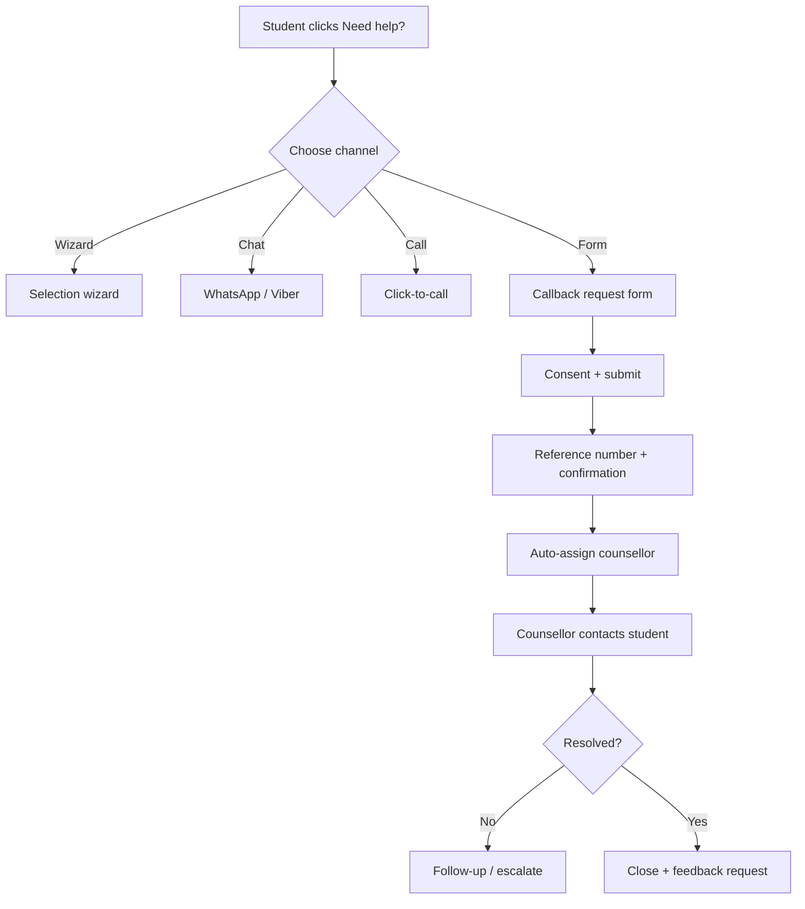

# 09 – Student Help Desk and Selection Guide

Many students and parents are unsure which college or program to choose and how admission works. ITinNepal provides **self-service guidance** and **human help**, with clear consent and no pressure.

## 1. Help Options Overview

| Option                         | Who it is for                     | Effort     | Response                        |
| ------------------------------ | --------------------------------- | ---------- | ------------------------------- |
| **Selection Wizard** (quiz)    | Unsure what to study              | 2–3 min    | Instant                         |
| **FAQ / Guides**               | Specific questions                | Self-serve | Instant                         |
| **Chatbot with handover** (P3) | Quick questions                   | Low        | Instant, then human             |
| **WhatsApp / Viber chat**      | Prefer messaging                  | Low        | Within working hours            |
| **Click-to-call**              | Prefer talking                    | Low        | Immediate during hours          |
| **Callback request form**      | Want a counsellor to contact them | Medium     | ≤ 24 h (target 4 working hours) |

A persistent **"Need help choosing?"** button appears on every public page (never covered by ads).

## 2. Selection Wizard

### 2.1 Questions (max 8)

1. What is your latest level? (SEE / +2 pass / Bachelor completed)
2. +2 stream and GPA (or expected range)?
3. Interests (check all): programming, networking, data/AI, web design, cybersecurity, business + IT, hardware.
4. Preferred study style: theory/maths-heavy, balanced, practical/project-based.
5. Budget for total course (ranges in NPR).
6. Preferred locations (district).
7. Willing to sit for an entrance exam? (Yes / No / Not sure)
8. Goal: job in Nepal, study abroad, higher studies/research, start a business.

### 2.2 Output

- Top 3 **programs** with reasons ("Strong maths background fits BSc CSIT").
- Top 5 **colleges** matching budget, location and entrance preference.
- Entrance info and next dates for each.
- Buttons: **Compare**, **Save**, **Talk to a counsellor**.

### 2.3 Scoring (Illustrative)

```
score(program) = w1*interest_match + w2*academic_fit + w3*goal_fit
score(college) = w1*program_score + w2*budget_fit + w3*location_fit
                 + w4*entrance_preference_fit + w5*data_verified_bonus
```

Rules: sponsored status must **not** affect score; show why each result matched; allow users to adjust answers.

## 3. Selection Process Guide (Content Standard)

For every program page and entrance page, include these sections.

### 3.1 Admission Pathways

| Pathway                 | Description                   | Show                                                                             |
| ----------------------- | ----------------------------- | -------------------------------------------------------------------------------- |
| Entrance exam           | Central or college-level test | Exam name, conducting body, syllabus, pattern, marks, fee, dates, cutoff history |
| Merit-based             | SEE/+2 GPA and subjects       | Minimum GPA, subject requirements                                                |
| Interview / counselling | College interview             | Typical format and documents                                                     |
| Mixed                   | Entrance + interview/merit    | Weightage if published                                                           |
| Foreign-affiliated      | University-specific criteria  | English proficiency, previous academic requirements                              |

> Content note: Entrance procedures, authorities and dates differ by university and year. Always link to the **official notice** and show the verification date. **VERIFY** before publishing.

### 3.2 Step-by-Step Timeline Template

1. Check eligibility (GPA, stream, subjects).
2. Choose programs and shortlist colleges.
3. Register / fill the entrance or admission form (deadline + official link).
4. Prepare: syllabus, past questions, model tests.
5. Appear in the entrance (admit card, venue, documents).
6. Merit list publication and college priority selection (if applicable).
7. Admission, document verification and fee payment.
8. Orientation and class start.

### 3.3 Document Checklist

- SEE/+2 mark sheets and character certificate
- Citizenship or birth certificate (as required)
- Passport-size photos
- Transfer/migration certificate where applicable
- Entrance admit card and result (if applicable)
- Fee payment receipts (keep copies)

### 3.4 "Do I Need an Entrance?" Decision Helper

```
Is the program run by a central university body with a common entrance?
 ├─ Yes → Show exam details + cutoff trend + prep resources
 └─ No  → Does the college run its own admission test?
         ├─ Yes → Show test info, sample patterns, interview details
         └─ No  → "Direct admission by merit/interview" + minimum criteria
```

### 3.5 Choosing Wisely – Guidance Content

- Compare **total cost** (not just semester fee) and ask about hidden charges.
- Check **affiliation/recognition** and the latest approval status.
- Review **labs, faculty, internship practice and project work**.
- Ask about **placement support** and request verifiable alumni outcomes.
- Visit the campus or request a virtual tour; talk to current students/alumni.
- Beware of guaranteed-placement or guaranteed-admission claims.

## 4. "Need Help?" Request Flow



### 4.1 Help Form Fields

| Field                                             | Required     | Notes                                                |
| ------------------------------------------------- | ------------ | ---------------------------------------------------- |
| Name                                              | Yes          |                                                      |
| Mobile number                                     | Yes          | Validate Nepali format; optional WhatsApp/Viber flag |
| Email                                             | No           |                                                      |
| Current status                                    | Yes          | SEE / +2 / Bachelor                                  |
| GPA / expected result                             | No           |                                                      |
| Interests                                         | No           | Multi-select                                         |
| Budget range (NPR)                                | No           |                                                      |
| Preferred district                                | No           |                                                      |
| Colleges/programs already considered              | No           | Prefilled if opened from a college page              |
| Question                                          | No           | Free text, 500 chars                                 |
| Preferred contact time and channel                | Yes          |                                                      |
| Consent (contact me)                              | Yes          |                                                      |
| Consent (share details with shortlisted colleges) | No, separate | Only if the student opts in                          |

Form behaviour: prefill from the page context (college/program), save a draft locally, rate-limit submissions, invisible CAPTCHA, confirmation with reference code `ITN-YYYY-NNNNN`.

### 4.2 Status Lifecycle

`New → Assigned → Contacted → Follow-up → Resolved / Closed (no response)`

### 4.3 SLAs

| Event                | Target                                      |
| -------------------- | ------------------------------------------- |
| Auto-confirmation    | Instant                                     |
| First human response | ≤ 24 h (target ≤ 4 working hours)           |
| Follow-up cadence    | 2 attempts over 3 days, then close politely |
| Resolution target    | ≤ 5 working days                            |
| Feedback request     | Within 24 h after closure                   |

## 5. Counsellor Guidelines

**Do**

- Listen first; ask about goals, budget and constraints.
- Present 2–3 suitable options with pros and cons.
- Share official links and verification dates.
- Disclose any sponsorship or commercial relationship.
- Keep notes factual and privacy-safe.

**Don't**

- Promise admission, scholarships or jobs.
- Pressure students toward a specific college.
- Share contact details with colleges without explicit consent.
- Contact outside agreed hours or after a student opts out.

### Call/Chat Script Outline

1. Greet and confirm identity and consent.
2. Understand: result, interests, budget, location, entrance willingness.
3. Explain programs and admission pathways simply.
4. Recommend a shortlist with reasons and next steps/dates.
5. Send a summary (WhatsApp/SMS/email) with links and checklist.
6. Ask permission for follow-up.

## 6. Counsellor Dashboard (Requirements)

- Queue with filters (status, district, program, age of request).
- Assignment rules (round-robin, language, district).
- Student summary card with context and consent flags.
- Notes, templates (canned responses), reminders.
- SLA timers and overdue alerts.
- Reports: volume, response time, resolution rate, satisfaction, top questions.

## 7. Data, Privacy and Safety

| Topic        | Rule                                                                                                                                                     |
| ------------ | -------------------------------------------------------------------------------------------------------------------------------------------------------- |
| Consent      | Separate, explicit checkboxes for contact and for sharing with colleges                                                                                  |
| Minimisation | Collect only what is needed; no ID documents in the help form                                                                                            |
| Retention    | Delete or anonymise closed requests after a defined period (e.g. 12 months)                                                                              |
| Access       | Role-based; counsellors see only assigned/regional requests                                                                                              |
| Security     | Encrypt at rest and in transit; audit access                                                                                                             |
| Minors       | Many users are under 18: keep language age-appropriate, involve parents where suitable, avoid marketing to minors without consent **VERIFY** local rules |
| Opt-out      | "Stop contacting me" honoured immediately                                                                                                                |
| Transparency | Plain-language note on how data is used and who sees it                                                                                                  |

## 8. Monetisation Boundaries for Help

- Help is **free** to students.
- If colleges pay for leads, share only **consented** leads, label them clearly and let students choose.
- Recommendations from the wizard and counsellors must remain unbiased and explainable.
- Keep ads off help and wizard pages.

## 9. Metrics

| Metric                        | Target                                                |
| ----------------------------- | ----------------------------------------------------- |
| Help request submission rate  | ≥ 2% of sessions on college pages (tune after launch) |
| First-response time           | ≤ 24 h                                                |
| Resolution rate               | ≥ 80%                                                 |
| Student satisfaction          | ≥ 4.3/5                                               |
| Wizard completion             | ≥ 60% of starts                                       |
| Wizard → saved/compare action | ≥ 40%                                                 |
| Consent-to-share rate         | Tracked (not optimised aggressively)                  |

## 10. Implementation Checklist

- ☐ `help_requests` and `help_notes` tables with indexes and audit
- ☐ Public API `POST /help-requests` with validation and rate limits
- ☐ Email/SMS/WhatsApp notifications to counsellors
- ☐ Counsellor dashboard (P1 basic, P2 advanced)
- ☐ Wizard question flow and scoring service with unit tests
- ☐ Entrance/selection content template filled for each program
- ☐ Consent text reviewed; privacy policy updated
- ☐ SLA alerts and weekly report
- ☐ Usability test with 8+ students/parents
